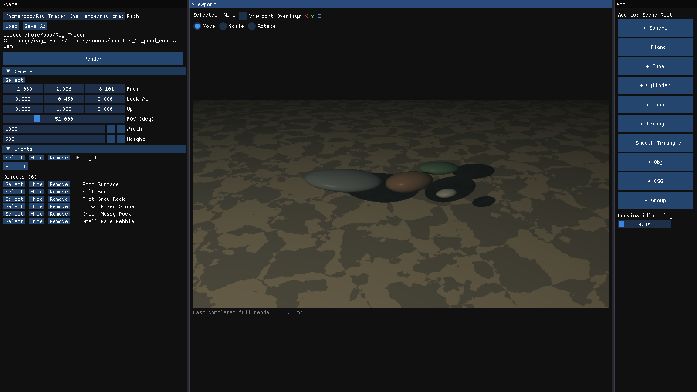
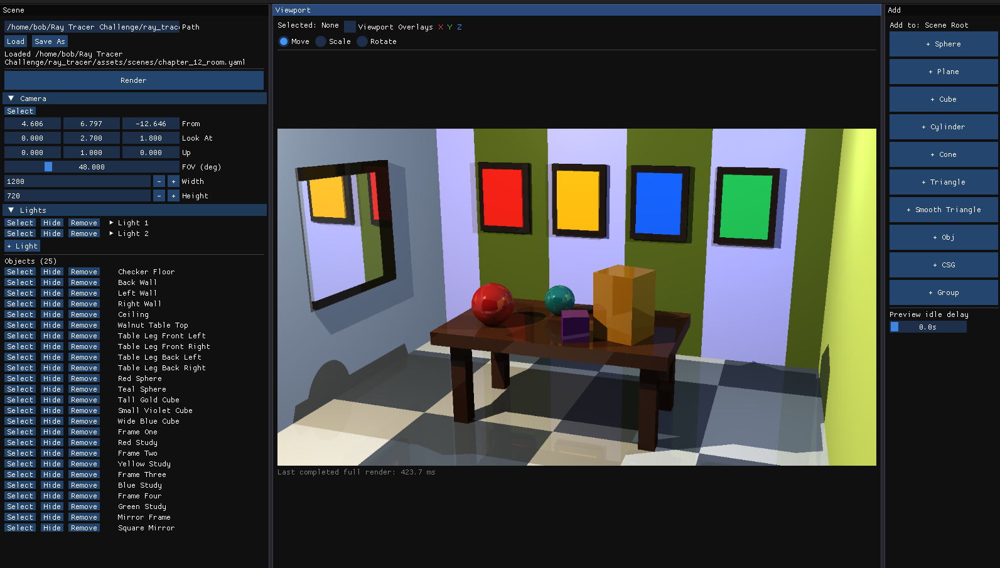
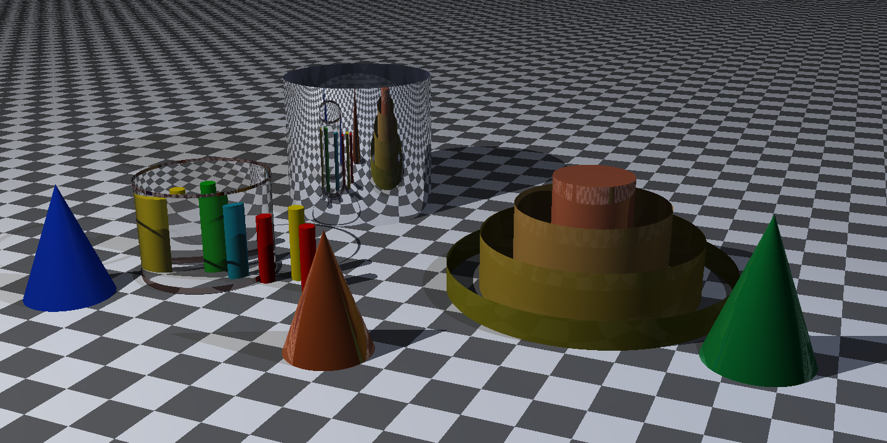
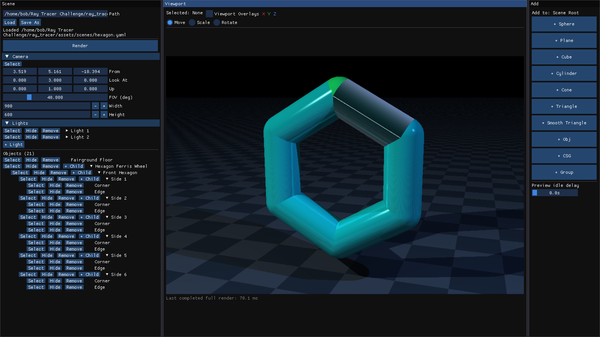
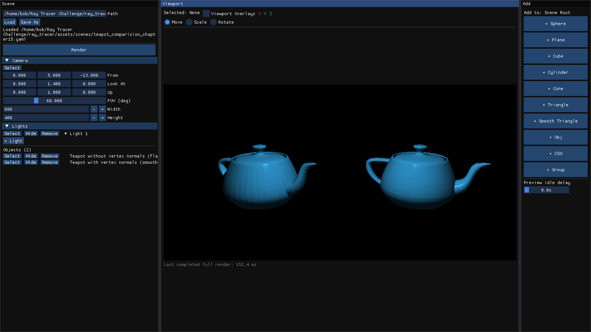
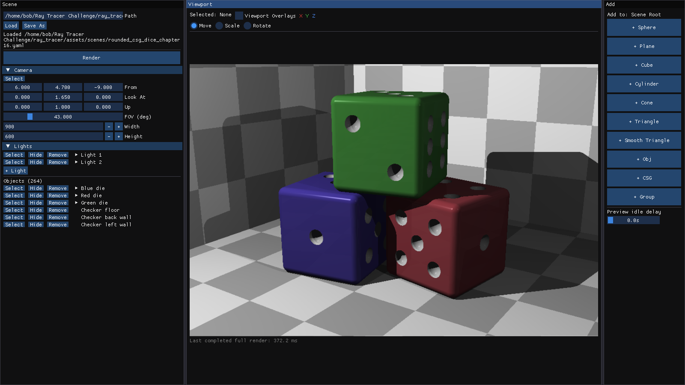

# Ray Tracer Challenge

Yet another implementation of *The Ray Tracer Challenge* by Jamis Buck, written 
in C++23. The goal is to build a ray tracer from scratch while following the 
book as closely as possible.

Along the way, I wanted an easier way to visualize the results and experiment 
with materials, transforms, cameras, and lights. That led to a scene editor 
built with Dear ImGui, GLFW, and OpenGL. Ray tracing runs on the CPU; the editor 
displays the rendered image and lets me change the scene interactively.

It started as a curiosity to play and understand the ray tracing concepts, it 
was/is immensely satisfying and incredibly fun to experiment/explore the concepts. 
It started out as if I can claim the world of graphics with just this book, but I
quickly realized I am just scratching the surface, and I have a lot to learn.

## Build and run

The project targets Linux, with Ubuntu 24.04 as the Docker base and reference host environment.

### Docker

With Docker available, install Invoke in your Python environment:

```sh
pip install invoke
# Alternatively: uv pip install invoke
```

Build the development image, start the container, and open its shell:

```sh
invoke docker.build
invoke docker.up
invoke docker.login
```

Inside the container, build and launch the scene editor:

```sh
invoke app.build
invoke app.run
```

The container uses the standard runtime by default. Use `invoke docker.up --gpu` to enable the NVIDIA runtime for GPU-accelerated OpenGL display; this requires the NVIDIA Container Toolkit. Ray tracing still runs on the CPU. `invoke docker.login` connects to `localhost:1122`.

### Native Ubuntu build

To build directly on Ubuntu 24.04, install the system packages listed in [dev-cpu.deps](docker/dependencies/dev-cpu.deps) and the Python tools listed in [pip3.txt](docker/dependencies/pip3.txt). Then run these commands from the repository root:

```sh
invoke app.build
invoke app.run
```

CLion can also import [CMakePresets.json](CMakePresets.json) and build the `scene_editor` target.

## Exploring scenes

Load one of the [scene files](assets/scenes), import an OBJ model, or build a scene 
in the editor. You can change materials, transforms, cameras, and lights, then 
render the result. Model paths are saved relative to the scene file.

To open a scene directly:

```sh
invoke app.run --args="assets/scenes/rounded_csg_dice_chapter16.yaml"
```

## Chapters and results

Chapters 1 and 3 cover tuples and matrices. They have tests but no standalone visual demos. Later chapters use either dedicated examples or YAML scenes loaded in the scene editor.

### Chapter 2: Drawing on a canvas

The projectile example writes a PPM image. This PNG is an export of that output.


### Chapter 4: Transformations

A clock face built by rotating and translating points.


### Chapter 5: Ray-sphere intersections

Casting rays onto a transformed sphere produces its silhouette.


### Chapter 6: Light and shading

Lighting gives the sphere its shape, shading, and specular highlight.


### Chapter 7: Making a scene

A camera, materials, and multiple objects come together in a scene. 
Both the GUI example and the PPM renderer produce visible output.
I played around with transforms to get very odd looking result.


### Chapter 8: Shadows

An eclipse example built with shadow rays.


### Chapter 9: Planes

Planes form a room containing transformed spheres.
Again played to generate a very odd looking result.


### Chapter 10: Patterns

Procedural patterns can be transformed, nested, and blended.
(notice the fixed pattern on sphere checkers, other shapes can be done as 
explained in bonus chapter of textures.)


Perturbing a pattern with noise produces less regular surfaces.


### Chapter 11: Reflection and refraction

The renderer supports reflective and transparent materials, refraction, and Schlick's approximation. The pond scene is one example from this stage.



### Chapter 12: Cubes

A furnished room built largely from transformed cubes.



### Chapter 13: Cylinders and cones

This [material study](assets/scenes/chapter_13_cylinders_cones.yaml) combines glass and mirror cylinders, stepped brass rings, and cones with matte cobalt, polished copper, and glazed emerald finishes on a checkerboard floor.



### Chapter 14: Groups

Groups let related objects share transforms and form larger structures.



### Chapter 15: Triangles and OBJ models

OBJ loading makes it possible to render triangle meshes. This comparison shows the same teapot without normals and with normals interpolation.



### Chapter 16: Constructive solid geometry

CSG combines shapes using union, intersection, and difference. The dice use these operations to create rounded edges and recessed pips.



## Bonus chapters

- **Bounding boxes and bounding volume hierarchies (BVH): implemented.** 
   The [dragon scene](assets/scenes/dragon_bonus_bvh.yaml) and [sphere grid](assets/scenes/bvh_spheres_5x5x5.yaml) 
   provide larger scenes to explore. This is really needed to drop down rendering times for complex scenes.

  

- **Soft shadows:** pending.
- **Image textures:** pending.

## Lessons learned

- I think most common theme for numbers was == does not mean anything for floating point numbers, its always ~= Approximations, 
  and small differences can result in salt and pepper noise in the final image, so I had to be careful with floating point comparisons.
- CPUs are slow for crunching numbers in large scope, might have to play/port to GPU for better numbers (realtime!?)
- Always cache the results of expensive calculations if they are reused. 
    (this exploded in terms of saving render time multiple times)
- Multithreading can do wonders 
- Build flags can change rendering times, but optimized builds can make debugging a 
  pain because variables may be missing out in debugger. I prefer `-Og -g` for debugging and `-O3` for release builds. `-g` adds debug symbols; the `-O` flag controls optimization.

    Same CPU renderer, tested on an Intel Core i7-10700K with GCC 13.3 and 16 render threads:

    - **Dragons:** [dragon_bonus_bvh_max_time_render.yaml](assets/scenes/dragon_bonus_bvh_max_time_render.yaml), 1000×800, with six dragon meshes and transparent bounding boxes.
    - **Simple:** [default.yaml](assets/scenes/default.yaml), 800×400, with one sphere and a checkerboard plane.

    | Build | Compiler flags | Dragons (s) | Simple (ms) |
    | --- | --- | ---: | ---: |
    | Unoptimized Debug | `-O0 -g` | 47.07 | 128.5 |
    | Debugging | `-Og -g` | 8.22 | 27.8 |
    | O2 | `-O2` | 5.04 | 21.8 |
    | Current Debug | `-O2 -g` | 5.05 | 22.6 |
    | O3 | `-O3` | 4.38 | 25.4 |
    | O3 with symbols | `-O3 -g` | 4.42 | 23.4 |
    | Release | `-O3 -DNDEBUG` | 4.39 | 21.6 |
    | RelWithDebInfo | `-O2 -g -DNDEBUG` | 5.10 | 24.7 |


- I tried to use constexpr everywhere, I don't think it helped much with performance, it didn't move any of render times (runtime) to compile time.
- Small improvements on bounding boxes, skipping identity transforms, etc were small changes but helped with render times.
- We are standing on shoulders of giants, so many algorithms and techniques for 
  each minute detail, I am still bothered by aliasing of the shapes, later 
  chapter-17 made it clear that I need to implement anti-aliasing, texture mapping, blurs, 
  different lights, so many endless possibilities

The most rewarding page while implementing was the [teapot competition](https://graphics.cs.utah.edu/courses/cs6620/fall2013/?prj=13) and getting to know 50 years ago was first rendering of teapot.

## Other resources

- [Physically Based Rendering](https://pbr-book.org/4ed/contents) — a detailed reference I would like to explore further.
- [Ray Tracing in One Weekend series](https://raytracing.github.io/) — another introduction to ray tracing that I wish I had looked at earlier.

## License

This project is licensed under the [MIT License](LICENSE).
