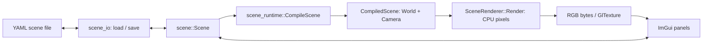

# Application architecture

`scene_editor` loads, edits, saves, and renders YAML scenes. It uses the same CPU ray tracer as the chapter examples. Dear ImGui provides the controls, GLFW owns the window and OpenGL context, and OpenGL displays the rendered pixels.

The main distinction is between **the editable scene description** and **the compiled objects used for rendering**. UI widgets edit `scene::Scene`; they do not directly edit the renderer's `World`.

## Data flow



## Code and ownership

Paths below are relative to `src/app/`.

| Area | Responsibility | Main files |
| --- | --- | --- |
| Entry point | GLFW/ImGui setup, main loop, startup scene, shutdown | [scene_editor_main.cpp](../src/app/src/scene_editor_main.cpp) |
| Authoring model | Plain C++ scene data that can be edited and serialized | [scene.h](../src/app/inc/app/scene/scene.h) |
| Scene files | YAML parsing, serialization, and model-path handling | [scene_yaml.cpp](../src/app/src/scene/scene_yaml.cpp) |
| Scene compilation | Convert authoring data into runtime objects, materials, patterns, lights, and camera; construct BVH groups | [scene_compiler.cpp](../src/app/src/scene/scene_compiler.cpp), [shape_catalog.cpp](../src/app/src/shape_catalog.cpp) |
| Application state | Current scene, compiled scene, selection, current file, and status messages | [scene_editor_app.h](../src/app/inc/app/scene_editor/scene_editor_app.h), [scene_editor_app.cpp](../src/app/src/scene_editor/scene_editor_app.cpp) |
| Editing controls | Scene/object/add panels, material and pattern widgets, camera controls, viewport overlays, and file dialogs | [scene_editor/](../src/app/src/scene_editor/) |
| Render scheduling | Background worker, cancellation, preview/full-render requests, and completed-image handoff | [render_controller.cpp](../src/app/src/scene_editor/render_controller.cpp), [render_state.h](../src/app/inc/app/scene_editor/render_state.h) |
| Rendering and display | Produce CPU pixels, convert them to RGB bytes, upload an OpenGL texture | [scene_renderer.cpp](../src/app/src/scene_editor/scene_renderer.cpp), [gl_texture.cpp](../src/app/src/scene_editor/gl_texture.cpp) |

The ray tracer's math, materials, shapes, OBJ parser, and rendering code live under [inc/app/](../src/app/inc/app/). Its headers do not use ImGui or YAML parser APIs.

These are logical code boundaries, not separate libraries. The current [app_lib target](../src/app/CMakeLists.txt) also compiles scene and editor implementation files and publicly links yaml-cpp and ImGui. `imgui_lib` is an interface target for GUI dependencies. The `scene_editor` executable and chapter demos reuse these targets.

## Scene data and editor state

[scene::Scene](../src/app/inc/app/scene/scene.h) contains a camera, lights, and a tree of objects. Its types use standard C++ containers and values rather than UI or ray-tracer runtime objects.

Each `scene::Object` has a name, transform, visibility flag, and one of three kinds of content:

- `ShapeSpec`: a primitive or OBJ source, with material and shadow settings.
- `GroupSpec`: child objects with a shared parent transform.
- `CsgSpec`: a union, intersection, or difference of two visible child objects, with optional material override and shadow settings.

Materials can contain recursive patterns. Runtime shape IDs are assigned during compilation; they are not stored as object IDs in YAML.

`SceneEditorApp` owns the authoring scene, an optional `CompiledScene`, and `EditorState`. Selection uses object paths through the authoring tree, or a light index, rather than runtime shape IDs.

`UiRenderState`, owned separately by the main function, holds the worker thread, cancellation/progress atomics, pending pixels, render IDs, timing, texture, and viewport interaction state. Neither this state nor `EditorState` is serialized into scene files.

## Loading, saving, and paths

On startup, the editor loads the scene path supplied as its first command-line argument. Without one, it loads `assets/scenes/default.yaml`. CMake supplies the default asset directory through `RAY_TRACER_ASSET_DIR`.

```sh
./build/src/app/scene_editor assets/scenes/default.yaml
```

The path textbox supplies the starting location for the ImGui **Load** and **Save As** dialogs. The editor also has an OBJ chooser for importing models.

Loading follows this sequence:

1. `scene_io::LoadSceneYaml(path)` parses the file and resolves relative OBJ sources against the YAML file's directory.
2. `SceneEditorApp::LoadScene` calls `scene_runtime::CompileScene` to create the runtime world and camera.
3. Only after parsing and compilation succeed does the app keep the new scene, reset selection, and update the current path. A failure preserves the previous authoring scene and compiled scene, and sets an error message for the UI.

`scene_io::SaveSceneYaml(scene, path)` serializes a copy of the authoring scene. Absolute OBJ paths in that copy become relative to the destination YAML directory, including sources inside groups and CSG objects. The in-memory paths remain unchanged, so **Save As** keeps referring to the same models.

Saving does not copy OBJ files or bundle assets. Moving a scene and its models together requires preserving their relative layout.

## Compilation and rendering

`scene_runtime::CompileScene` creates a `CompiledScene` containing a `ray_tracer::World` and `ray_tracer::Camera`. It creates concrete shapes through the shape catalog, applies transforms and materials, loads OBJ meshes, omits hidden objects/lights, and subdivides finite geometry into BVH groups where applicable. Bounds are populated before rays are traced.

The render lifecycle is:

1. **Startup/load:** request a full-resolution render of the successfully compiled scene.
2. **Editing:** panels and viewport controls report scene changes or camera movement. `RequestPreviewRender` records the request. It cancels an active full render, but lets an active preview finish.
3. **Prepare:** camera-only changes can update the compiled camera while reusing the world. Other edits recompile the scene. Preparation happens on the UI thread.
4. **Render:** `StartRender` joins the previous worker and starts a background thread with a captured `CompiledScene` value. Its world contains shared pointers to shapes; this is not a deep copy of every object.
5. **Parallel work:** `SceneRenderer::Render` uses [ParallelRenderRows](../src/app/inc/app/rendering/render_rows.h) to distribute rows across CPU workers. Workers claim rows atomically, update progress, and check cancellation while tracing pixels.
6. **Display:** the worker publishes completed pixels under a mutex. The UI thread converts them with `SceneRenderer::ToRgb8`, calls `GlTexture::UploadRgb`, and displays the texture through ImGui. OpenGL calls stay on the UI thread.
7. **Refine:** after a preview is displayed and interaction stops, the controller starts a full render after the configured idle delay. That delay defaults to zero. Completed images are uploaded before another deferred render starts.
8. **Shutdown:** the main function calls `StopRender` to cancel and join the worker before shutting down ImGui and GLFW.

Previews sample a lower-resolution grid using the full camera's rays. Their height is roughly one eighth of the full height, with aspect-ratio and minimum-size handling. Full renders trace every output pixel. This preview mechanism is separate from anti-aliasing.

The NVIDIA container runtime is optional and enables GPU-backed OpenGL display. It does not move the ray-tracing work onto the GPU.

## Scene-file format

Checked-in scenes use `version: 1`. The loader/compiler APIs are free functions declared in [scene_yaml.h](../src/app/inc/app/scene/scene_yaml.h) and [scene_compiler.h](../src/app/inc/app/scene/scene_compiler.h).

Use working assets as examples instead of maintaining a second copy of the schema here:

- [default.yaml](../assets/scenes/default.yaml): camera, light, sphere, plane, materials, and a checker pattern.
- [hexagon.yaml](../assets/scenes/hexagon.yaml): nested groups and shared transforms.
- [teapot_comparision_chapter15.yaml](../assets/scenes/teapot_comparision_chapter15.yaml): relative OBJ sources and flat/smooth meshes.
- [rounded_csg_dice_chapter16.yaml](../assets/scenes/rounded_csg_dice_chapter16.yaml): CSG operations and nested objects.

Important schema details:

- A camera includes `from`, `to`, `up`, `fov_deg`, and `resolution`.
- Lights use `position`, `color`, and optional `visible`.
- Objects require a name, type, and transform. Shapes also require material and `cast_shadow`; groups and CSG objects contain `children` instead of a shape specification.
- Shape types are `sphere`, `plane`, `cube`, `cylinder`, `cone`, `triangle`, `smooth_triangle`, and `obj`. Cylinders/cones accept `bounds`; triangles use `vertices`; smooth triangles also use `normals`; OBJ objects use `source`.
- Binary patterns use a two-element `children` sequence. Supported types are `solid`, `stripe`, `gradient`, `ring`, `checkers`, `radial_gradient`, `uv_checkers`, `blended`, and `perturbed`. `uv_checkers` adds `width`/`height`; `perturbed` uses a scalar `scale` and a nested `source` pattern.

## Current limitations

- Unsaved-change tracking and close/load confirmation are not implemented.
- A scene path on the command line opens the GUI. There is no dedicated headless YAML-rendering command shipped with the application.
