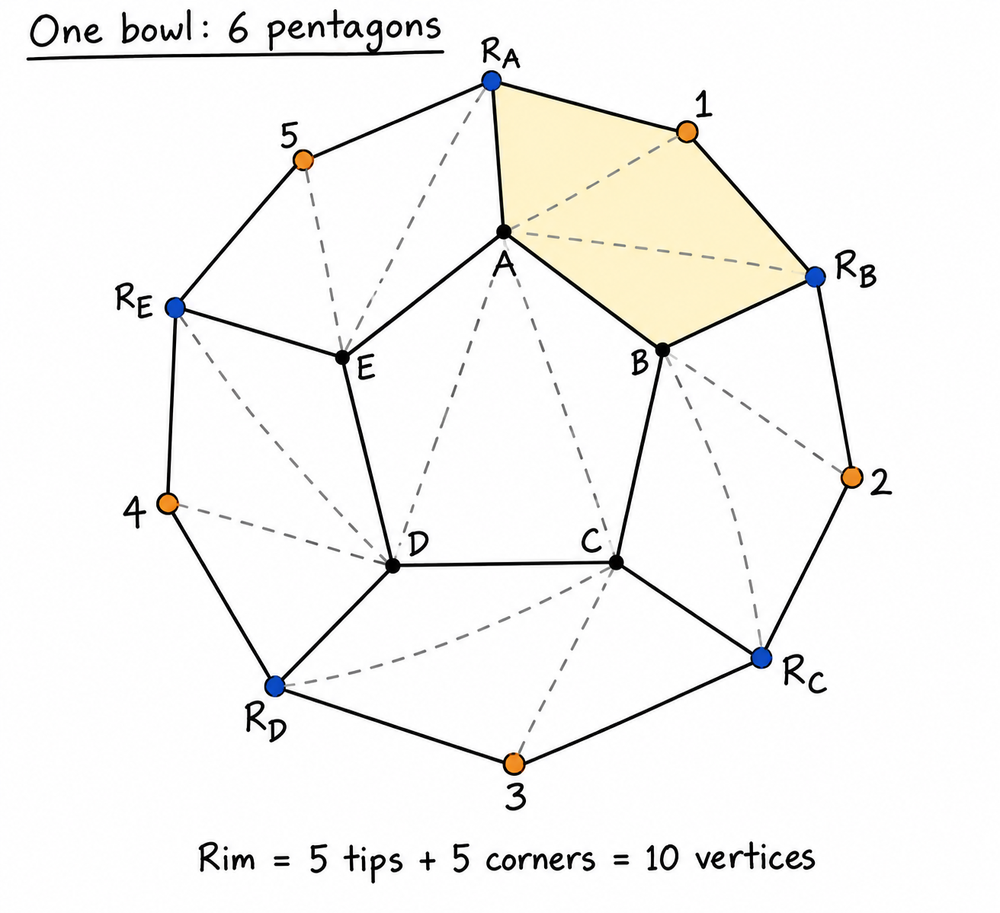

# Building a dodecahedron from triangles

Open [chapter_15_triangle_solids.yaml](../assets/scenes/chapter_15_triangle_solids.yaml) in the scene editor and expand **Dodecahedron (12 pentagonal faces)**. It contains 36 triangle objects: three for each of its 12 pentagonal faces. The example also contains a separate **decahedron**, which has 10 triangular faces.

## Think of two bowls

Unlike a pyramid, a dodecahedron has no apex. Imagine making a bowl from one bottom pentagon and five pentagonal walls, then joining it to an identical upside-down bowl.



This is a schematic view of an already folded bowl, not a flat paper net or a drawing to measure coordinates from.

- **A–E** are the five corners of the bottom pentagon.
- **Orange 1–5** are the outer tips of the five wall panels.
- **Blue R_A–R_E** are the five additional rim corners between those tips.
- **Solid black lines** separate pentagonal panels and outline the rim.
- **Dashed lines** split each flat pentagon into three triangles; they are not folds.

For example, the wall attached to bottom edge A–B has five corners:

```text
A → B → R_B → 1 → R_A → A
```

The next wall is `B → C → R_C → 2 → R_B → B`. These two walls share the edge B–R_B. Repeat around the bottom pentagon to make all five walls.

The open rim follows ten vertices:

```text
R_A → 1 → R_B → 2 → R_C → 3 → R_D → 4 → R_E → 5 → R_A
```

Fit the upside-down second bowl to this entire zigzag rim, matching its high points to the first bowl's low points. Merge matching corners and edges; do not add faces connecting only the five orange tips. Each bowl has six pentagonal panels, giving 12 panels in the completed solid. Three pentagons meet at each corner.

## Where the coordinates come from

A regular dodecahedron can be built from 20 vertices using the golden ratio:

```text
φ   = (1 + √5) / 2 ≈ 1.618034
1/φ ≈ 0.618034

(±1, ±1, ±1)       8 vertices
(0, ±1/φ, ±φ)      4 vertices
(±1/φ, ±φ, 0)      4 vertices
(±φ, 0, ±1/φ)      4 vertices
```

Each sign is chosen independently. These are local-space coordinates before the group's translation, rotation, and scale. The awkward-looking decimals in the YAML are rounded values of φ and 1/φ, not individually guessed positions.

Coordinates alone are not enough: each face must identify five connected, coplanar vertices in perimeter order. The example already supplies that connectivity through its triangle objects.

## Split each pentagon into three triangles

For any pentagonal face whose ordered corners are `[P, Q, R, S, T]`, use:

```text
Triangle 1: [P, Q, R]
Triangle 2: [P, R, S]
Triangle 3: [P, S, T]
```

The three triangles share P and cover the same flat pentagon. Applying this to all 12 faces gives **12 × 3 = 36 triangles**. Keep the vertex winding consistent so normals face outward.

In the YAML, these children are named **Pentagon 1 - Triangle 1**, **Pentagon 1 - Triangle 2**, and so on. Each child has a `vertices` list of three XYZ points and an identity transform. The enclosing group positions, rotates, and scales the entire solid.

To edit a triangle, select it and change **Geometry → Vertex 1–3**, or edit its `vertices` list in the YAML. Shared corners are currently repeated in multiple triangle objects: moving a corner consistently requires updating every triangle that uses it. For positioning or resizing the whole dodecahedron, edit the group's transform instead.
